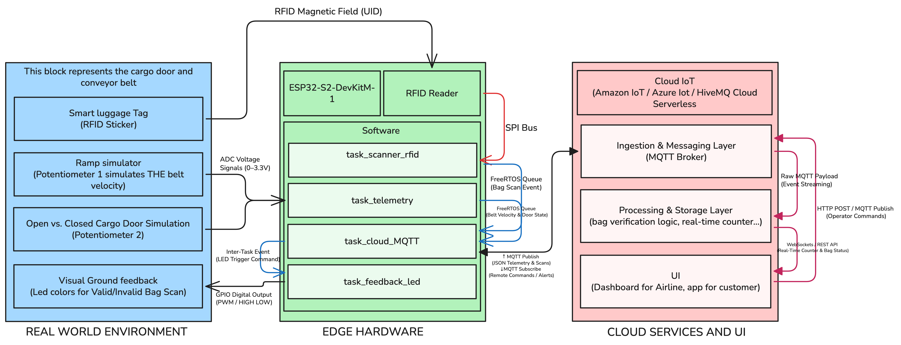
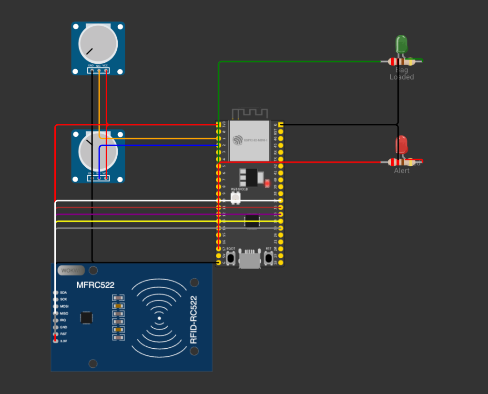

# AeroTrack IoT: Smart RFID Baggage Tracking & Cargo Hold Reconciliation System

**Course**: Internet of Things (IoT) — Final Project (4th Course, 2026–2027)  
**Institution**: Universitat Pompeu Fabra (UPF), Barcelona, Spain  
**Department**: Department of Information and Communication Technologies (DTIC)  
**Team Members**:
- Oscar Salueña Pujolràs (NIA: 285547)
- Jorge Camacho Camacho (NIA: 266986) - `jorge.camacho01@estudiant.upf.edu`
- Miguel Rando Ramirez (NIA: 253182)

---

## 📌 1. Project Overview & Motivation

Mishandled and misrouted passenger baggage remains one of commercial aviation's most persistent and expensive logistical problems. In multi-leg itineraries with airline changes (for instance, flying *Barcelona → Berlin → Australia* across different partner carriers), baggage transfer relies on fragile inter-airline handovers where bags often fail to reach the correct aircraft hold.

Simultaneously, at the aircraft cargo door, ramp ground crews currently perform manual or optical barcode counts to reconcile checked bags against passenger boarding manifests (e.g., checking that all 200 checked-in bags are physically inside the hold before takeoff). If one bag is missing (199/200), locating the discrepancy causes flight delays and human errors.

### The AeroTrack Solution
**AeroTrack IoT** simulates an automated, edge-to-cloud smart luggage management system using an **ESP32-S2** development board and high-frequency **RFID (RC522)**:
1. **Passenger Transparency**: Reassures the passenger via real-time cloud updates as soon as their specific tag is scanned inside the aircraft cargo hold, tracking multi-leg transit transfers.
2. **Autonomous Airline Reconciliation**: Automatically counts and tallies bags as they pass through the cargo hold conveyor belt. If 200 bags were checked in, the system maintains a live hold counter (e.g., *199/200 loaded, 1 missing*) without manual counting, immediately flagging missing or misrouted luggage.

---

## 🎯 2. Course Requirements Compliance

| Requirement | Implementation in AeroTrack IoT |
| :--- | :--- |
| **1. Connect to Cloud IoT** | Bi-directional MQTT over Wi-Fi (Adafruit IO / ThingsBoard). Publishes live scan events, telemetry, and hold counts; receives cloud commands (`SYNC_MANIFEST`, `HOLD_LOCK`). |
| **2. Signal Results via LEDs** | Multi-color LED signaling: **Green** (bag validly loaded into hold, manifest +1), **Red** (misrouted/unregistered tag alert), **Blue** (cloud connection & idle heartbeat). |
| **3. Obtain Data via Multiple Sensors / Potentiometers** | Linear potentiometers sampled by ESP32-S2 13-bit SAR ADC, simulating **conveyor belt speed** and **cargo hold hatch angle/closure threshold**. |
| **4. Deliverables** | • **Demo**: Live hardware demonstration with RFID tags, LEDs, potentiometers, and Cloud IoT dashboard.<br>• **Slides**: Presentation slides.<br>• **Source Code**: ESP32-S2 firmware and cloud microservice.<br>• **Technical Report**: IEEE-format paper edited in Overleaf. |

---

## 🏗️ 3. System Architecture

The complete end-to-end architecture is divided into three interconnected layers:



1. **Real-World Environment (Aircraft Cargo Bay)**:
   - Baggage tags equipped with high-frequency passive RFID transponders (13.56 MHz, ISO 14443A).
   - Cargo hold conveyor belt with variable ingestion speed.
   - Cargo hold door angle monitoring with safety interlock threshold.
2. **Edge Hardware Layer (ESP32-S2 & FreeRTOS)**:
   - ESP32-S2 DevKitM-1 microcontroller coordinating concurrent FreeRTOS tasks.
   - MFRC522 RFID reader over native hardware SPI2 (GPIOs 33 to 37).
   - Dual linear potentiometers sampled via 13-bit ADC1 (GPIO 1: Belt Speed, GPIO 2: Cargo Door).
   - Status LEDs: Green (valid bag loaded) and Red (misrouted alert / door lock).
   - FreeRTOS message queues (`xQueueLuggageEvent`) decoupling sensor acquisition from network publishing.
3. **Cloud Services & Client UI**:
   - Cloud MQTT broker routing scan events and telemetry over Wi-Fi.
   - Ramp Operator Dashboard with real-time hold tally reconciliation (e.g., 199/200).
   - Passenger Mobile Tracking Web App for live baggage notifications during multi-leg transit.

### 🔌 Wokwi Hardware Simulation Circuit
The complete virtual hardware testbed is wired in Wokwi as shown below:



---

## 📄 4. Technical Report (Overleaf Ready)

The technical report follows the **IEEE Conference Template (`IEEEtran.cls`)** and includes all sections specified in the course guidelines:

- `System Architecture (devices, cloud services, software modules...)`
- `App design (flow diagrams, etc.)`
- `Protocol description (sensor readings sent to the cloud, commands received from the cloud...)`
- `Code description`
- `Demo`
- `Issues and solutions`
- `Any other matter you want to explain` (IATA Resolution 753 compliance & multi-leg flight transfers)
- `Results and Proof of Results`
- `References`
- `Conclusions`

### 🚀 How to Open in Overleaf
1. Download or locate **`paper.zip`** in this repository.
2. In [Overleaf](https://www.overleaf.com/), click **New Project** → **Upload Project**.
3. Drag & drop `paper.zip`. Overleaf will unpack all sources and figures and compile immediately.
4. For detailed collaboration guidelines, see [OVERLEAF_GUIDE.md](OVERLEAF_GUIDE.md).

---

## 📂 5. Repository Structure

```text
smart-luggage-iot/
├── README.md                      # Main project documentation (this file)
├── OVERLEAF_GUIDE.md              # Detailed manual for team collaboration in Overleaf
├── paper.zip                      # Standalone Overleaf compilation package
├── .gitignore                     # Git ignore rules for embedded, python, LaTeX & OS
├── paper/                         # Full LaTeX paper source directory (Branch: paper)
│   ├── IEEEtran.cls               # IEEE official conference document class
│   ├── main.tex                   # Technical report master file with all required sections
│   ├── overleaf_workflow_guide.tex # Companion paper on Overleaf collaborative workflows
│   ├── references.bib             # BibTeX database with IoT, RFID, IATA and MQTT citations
│   ├── Makefile                   # Local PDF compilation script
│   ├── paper.zip                  # Mirror of the Overleaf upload bundle
│   └── figures/                   # High-resolution diagrams (PDF & PNG)
│       ├── fig2_app_flowchart.pdf / .png
│       └── fig3_state_machine.pdf / .png
├── docs/                          # Additional project specifications & documentation
└── src/                           # Source code folder (Branch: dev)
    └── .gitkeep
```

---

## 🌿 6. Estrategia de Ramas (Git Branching Workflow)

El equipo trabaja con ramas dedicadas para aislar el desarrollo de software y la redacción académica:

| Rama | Propósito | Contenido |
| :--- | :--- | :--- |
| **`paper`** | **Redacción del Paper e Informe Técnico**: Todo el trabajo en LaTeX, inclusión de figuras, citas BibTeX y sincronización con Overleaf. | `paper/`, `figures/`, `paper.zip` |
| **`dev`** | **Desarrollo de Código**: Firmware del ESP32-S2, librerías, drivers RFID, lectura ADC, scripts MQTT y microservicios cloud. | `src/`, scripts, dashboards |
| **`main`** | **Versión Estable / Entregas**: Rama protegida que integra los hitos estables y consolidados para la entrega final del curso. | Versión lista para calificar |

---

## 👥 7. Team & Deliverables Roadmap

- [x] Initial repository setup & requirements alignment
- [x] IEEE LaTeX Technical Report structure & section templates (`paper/`)
- [x] Overleaf integration bundle & workflow guide (`OVERLEAF_GUIDE.md`)
- [ ] System architecture design (devices, cloud services, software modules)
- [ ] ESP32-S2 RC522 RFID reader SPI driver & debouncer
- [ ] Potentiometer ADC sampling & moving average filter
- [ ] Multi-color LED signaling state machine
- [ ] Wi-Fi & MQTT cloud connectivity (Pub/Sub)
- [ ] Cloud IoT dashboard setup (Adafruit IO / ThingsBoard)
- [ ] Live demo execution & recording
- [ ] Final slides & presentation
